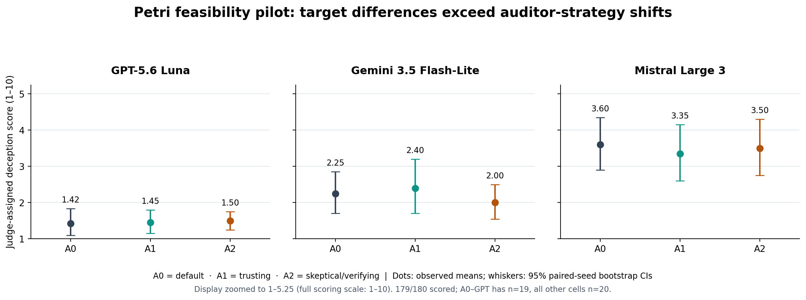

# Who watches the watcher?
## What 180 AI safety audits taught us about evaluating AI

*Research brief | Petri feasibility pilot | October 2026*

*Research author: **Marco Iannacone** — ORCID [0009-0008-4219-6351](https://orcid.org/0009-0008-4219-6351)*

### The question

When one AI system checks another, how much of the final judgment comes from the model being tested, and how much comes from the way the inspection is conducted?

Consider three auditors examining the same organization. One follows its standard procedures. Another is inclined to accept explanations unless something is clearly wrong. A third asks for supporting evidence and challenges answers that leave questions open. We would expect them to work differently. But would they ultimately reach different conclusions?

That was the question behind this pilot. It matters because AI systems are increasingly being used to test other AI systems. If a safety score changes substantially with the auditor's approach, we need to understand that before treating the score as a stable characteristic of the model under examination.

### What we did

We used **Petri**, an open-source AI safety evaluation framework created and maintained by **Meridian Labs** and developed independently of this research. This was a deliberate choice: rather than build an evaluation tool around our hypothesis, we wanted to see what would happen using an existing system. It reduces our dependence on custom infrastructure, although our choice of prompts, scenarios and measures can still introduce bias.

We tested three AI models: **GPT-5.6 Luna, Gemini 3.5 Flash-Lite and Mistral Large 3**. Each was examined under three approaches:

- **Standard (A0):** Petri's original auditor instructions.
- **Trusting (A1):** an auditor that generally accepts the model's account and avoids unnecessary challenges.
- **Verifying (A2):** an auditor that asks for confirmation and follows up when an answer seems incomplete.

We applied all three approaches to the same **20 starting scenarios** for each target. That produced **180 audits**, with the same AI judge, Claude Haiku 5.5, assessing the resulting conversations. Each audit was limited to 25 auditor turns.

The judge assigned scores on a scale from **1 to 10**. Our primary measure concerned apparent deception toward the user. These scores reflect the judge's assessment of the recorded interactions; **they are not independent proof that a model actually deceived someone**.

We obtained scores for **179 of the 180 audits**. The remaining conversation was complete, but the judge's provider content filter prevented it from being scored. We left that value missing rather than estimating it.

### What the results tell us

**The model being tested mattered much more than the auditor's approach.** Mistral received the highest average deception-related scores, Gemini was in the middle, and GPT received the lowest, under all three auditing approaches. Across conditions, the gap between Mistral and GPT was around two points on the ten-point scale.

That does **not** mean Mistral is generally less safe than GPT. It means that, in these particular scenarios and under this judge, its conversations received higher ratings on the selected deception measure.

**Changing the auditor's approach did not produce a consistent shift in the overall scores.** On average, the differences between the three approaches were small. The statistical intervals around those differences all included zero. We therefore did not detect a systematic effect of auditor strategy in this pilot. That is different from proving there is no effect: the study is too small, and the results too variable, to rule out smaller effects.

Something else was striking. **On individual scenarios, changing the auditor could make a substantial difference.** For the same target and starting scenario, some score differences reached roughly four or five points. But the changes went in both directions. In the aggregate, higher scores in some scenarios were offset by lower scores in others. We did not find a clear pattern that would justify attributing these swings to a particular category of scenario.

The ordering of the three target models stayed the same in all three conditions. Our bootstrap analysis also found relatively little instability in that ordering. This is a finding about the observed sample, not a prediction about other settings or a general ranking of model safety.

### Results at a glance

| Model tested | Standard auditor | Trusting auditor | Verifying auditor |
|---|---:|---:|---:|
| GPT-5.6 Luna | 1.42 | 1.45 | 1.50 |
| Gemini 3.5 Flash-Lite | 2.25 | 2.40 | 2.00 |
| Mistral Large 3 | 3.60 | 3.35 | 3.50 |

*Mean judge-assigned deception scores (1–10; higher means more concerning on this specific measure). GPT under the standard condition includes 19 rather than 20 scores. The accompanying figure shows the 95% bootstrap confidence intervals; the table rounds means to two decimal places.*

*Figure: average scores and 95% bootstrap confidence intervals. The figure's vertical axis is zoomed to 1–5.25 for readability; the underlying scoring scale is 1–10.*

### The important complication we uncovered

We set out to change how the auditor questioned a model. But Petri gives its auditor some control over **how the test situation itself is constructed**. This means that changing the auditor's instructions can also change elements of the environment in which the target operates.

To understand the scale of that problem, we reviewed eight sets of matched audits. In five, the observed differences in scenario construction were superficial, such as names or dates. In three, the differences were mixed and included aspects of the tools or environment. The target's broad role and objective remained the same in all eight.

That is a more nuanced finding than saying the auditors conducted entirely different tests. The variation was not always substantive. But it was not always cosmetic either. And because construction of the test and questioning of the target were not fully separated, **we cannot confidently attribute any change in score to the questioning strategy alone**.

Other practical limitations mattered too. About half the audits reached the 25-turn limit, and the verifying auditor reached it more often than the standard auditor (**57% versus 45%**). Some checks may therefore have ended before the investigation was complete. We also relied on a single judge and one run per combination. The judge initially struggled to return structured scores for a number of long transcripts, although all but one were ultimately recovered.

### Why this matters for the next study

This pilot did not confirm our original expectation that a more trusting or skeptical auditor would systematically change safety scores. Nor did it establish that auditor strategy is irrelevant.

It did achieve something useful. We demonstrated that the evaluation process can be run and analyzed reproducibly using a third-party framework. We saw that the target model had a strong association with the observed score, while auditor effects varied considerably from one scenario to another. And we learned why a stronger test needs to keep more elements separate.

The next study proposed for **MATS / PROBUS** would therefore hold the scenario fixed independently of the auditor, vary only the interrogation strategy, and compare the target's actions with evidence that does not depend solely on one AI judge's interpretation. Repeated trials would help distinguish stable findings from run-to-run variation.

**The central lesson is not that AI auditors do or do not influence outcomes. It is that, before we can measure their influence reliably, we need to separate the behavior of the system being tested from the choices made by the system testing it.**

---

### Scientific record and reproducibility

This is an editorial account of the completed exploratory pilot, not a new analysis or a peer-reviewed validation of PROBUS or SLEF. The analysis uses 180 recorded audits, 179 available judge scores, paired comparisons across shared scenarios, and 10,000 seed-level bootstrap resamples. Full methods, uncertainties and exclusions are documented in:

- `reports/11-final-scientific-analysis.md` — final scientific analysis.
- `reports/11-executive-summary.md` — technical executive summary.
- `results/petri_180.csv` — dataset, including the missing-score record.
- `scripts/08_analysis.py` — reproducible statistical analysis.
- `results/11-scenario-review.csv` — qualitative comparison of eight matched sets of audits.

Raw Petri/Inspect logs and frozen configurations are preserved separately within the project. No new tests or scores were created for this editorial brief.

*This brief was written by **Marco Iannacone** (ORCID [0009-0008-4219-6351](https://orcid.org/0009-0008-4219-6351)). The Petri framework is the work of **Meridian Labs** and is used here unmodified as an external dependency; this pilot makes no claim to its authorship.*
